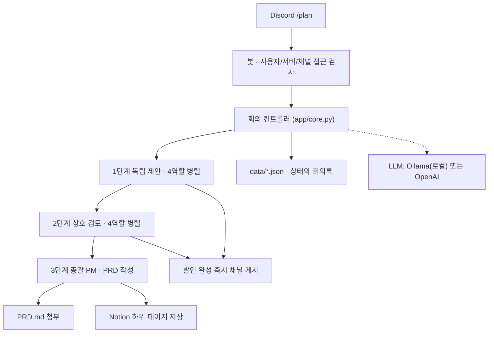

# Discord AI 기획팀 봇

Discord 채널에서 `/plan 주제`를 입력하면 AI 역할 5개(기획자·개발자·마케터·비평가·총괄 PM)가 회의를 진행한다. 회의가 끝나면 PRD(제품 요구사항 문서)를 작성해 Notion에 저장한다.

- **무료 로컬 실행:** [Ollama](https://ollama.com)로 내 PC의 GPU에서 모델을 돌린다. API 비용이 들지 않는다.
- **유료 API 선택 가능:** `.env`의 설정 한 줄로 OpenAI Responses API로 바꿀 수 있다.
- **채팅처럼 진행:** 발언이 하나 완성될 때마다 채널에 바로 올라오고, 단계마다 진행 알림이 표시된다.
- **공개 서버 불필요:** Discord Gateway에 봇이 직접 접속하는 방식이다. 인바운드 포트, ngrok, 웹훅 URL이 필요 없다.

> 역할은 같은 모델에 서로 다른 시스템 지침을 주고 따로 호출하는 방식으로 구현한다. 역할마다 독립된 인격이나 다른 모델이 있는 것은 아니다. PM의 초안이 실제 사용자 검증이나 사업 타당성 검증을 대신하지 않는다.

---

## 1. 동작 흐름



| 단계 | 실행 | 모델에 전달되는 자료 | 결과 |
|---|---|---|---|
| 1. 독립 제안 | 4역할 병렬 | 주제만 | 관점별 첫 의견 |
| 2. 상호 검토 | 4역할 병렬 | 주제 + 1단계 의견 4개 | 반박·보완 |
| 3. PM 종합 | 총괄 PM 1회 | 주제 + 발언 8개 | Markdown PRD |

- **역할 분담:** 기획자는 문제·고객·MVP, 개발자는 구현·데이터·제약, 마케터는 고객 확보·수익·실험, 비평가는 실패 조건을 맡는다.
- **회의 규모:** 회의 1건에 모델을 9번 호출한다. 출력 상한은 역할 발언 700토큰, PM 2,400토큰이다.

## 2. 프로젝트 구조

```text
app/
  bot.py            Discord 슬래시 명령, 설정 검증, LLM 호출(Ollama/OpenAI), 회의 작업 수명 관리
  core.py           역할 정의, 3단계 회의 진행, 메시지 분할, 원자적 JSON 저장
  notion.py         Notion 페이지 생성, 블록 분할 저장, 저장 진행점(offset) 관리
  retry_notion.py   AI 재호출 없이 완성된 PRD를 Notion에 다시 저장
tests/
  test_core.py      단계별 맥락 격리, 발언·진행 알림 수, 실패 전파, 저장/분할
  test_notion.py    블록 분할, 완료 작업 재저장 방지, 불확실한 POST 재시도 금지
scripts/
  setup.ps1         원클릭 설치 (Python·venv·패키지·.env·Ollama 모델·테스트)
  run.ps1           봇 실행 (미설치 시 setup 먼저)
  autostart.ps1     로그인 자동 실행용 (중복 실행 방지, 비정상 종료 시 재시작)
  autostart-install.ps1 / autostart-uninstall.ps1   시작프로그램 바로가기 등록·해제
setup.cmd, run.cmd  더블클릭 실행용 래퍼 (실행 정책 우회)
autostart-install.cmd, autostart-uninstall.cmd   자동 실행 등록·해제 래퍼
.env.example        설정 템플릿 (항목별 한글 주석)
Dockerfile, compose.yaml
```

## 3. 빠른 시작 (Windows) — 토큰만 넣으면 실행

사전 준비: [Python 3.12+](https://www.python.org/downloads/), [Ollama](https://ollama.com/download)

1. **`setup.cmd` 더블클릭.** 다음 작업이 자동으로 진행된다.
   - Python 확인
   - `.venv` 생성과 패키지 설치
   - `.env` 생성 (이미 있으면 덮어쓰지 않는다)
   - Ollama 모델 다운로드
   - 테스트 실행
   - 비어 있는 설정 항목 안내
2. **`.env`를 열어 토큰과 ID 입력.** 안내된 항목만 채우면 된다. 발급 방법은 각 항목 위 주석과 [4. 외부 서비스 준비](#4-외부-서비스-준비)에 있다.
3. **`run.cmd` 더블클릭.** 봇이 시작된다. 설정이 빠졌거나 Ollama가 꺼져 있으면 원인을 출력하고 종료한다.

`setup.cmd`는 여러 번 실행해도 안전하다. 모델을 바꾼 뒤에도 다시 실행하면 새 모델을 내려받는다.

### 로그인 시 자동 실행 (Windows)

- **등록:** `autostart-install.cmd`를 더블클릭한다. 시작프로그램 폴더에 바로가기(`DiscordPlanningBot.lnk`)가 생기고, 다음 로그인부터 봇이 최소화 창으로 실행된다. 관리자 권한은 필요 없다.
- **해제:** `autostart-uninstall.cmd`를 더블클릭한다. 이미 실행 중인 봇은 종료되지 않으므로 봇 창을 직접 닫는다.
- **종료:** 작업 표시줄의 최소화된 봇 창을 닫으면 봇도 종료된다.
- **Ollama 대기:** 봇이 Ollama 앱보다 먼저 시작되면 `OLLAMA_STARTUP_WAIT_SECONDS`(기본 120초) 동안 연결을 다시 시도한다.
- **자동 재시작:** 네트워크 끊김 등으로 비정상 종료하면 10초에서 최대 60초까지 대기 시간을 늘리며 다시 시작한다. 60초 안에 5번 연속 종료되면 설정 오류로 보고 멈춘 뒤, 원인을 볼 수 있도록 창을 열어 둔다.
- **중복 실행 방지:** 자동 실행 중에 `run.cmd`를 실행하면 "이미 실행 중"을 안내하고 종료한다.
- **폴더 이동:** 바로가기에 현재 폴더 경로가 저장된다. 프로젝트 폴더를 옮기면 `autostart-install.cmd`를 다시 실행한다.

### 수동 설치 (Windows PowerShell)

```powershell
py -3.13 -m venv .venv
.\.venv\Scripts\python.exe -m pip install -r requirements.txt
Copy-Item .env.example .env      # 이미 .env가 있으면 실행하지 않는다
ollama pull gemma3:4b
```

macOS / Linux:

```bash
python3 -m venv .venv && source .venv/bin/activate
python -m pip install -r requirements.txt
cp -n .env.example .env
```

`.env`를 열어 값을 채운다. 각 항목의 의미와 발급 위치는 `.env.example`의 주석에 있다. 필수 항목은 다음과 같다.

| 항목 | 필수 조건 |
|---|---|
| `DISCORD_TOKEN`, `DISCORD_GUILD_ID`, `DISCORD_CHANNEL_ID`, `ALLOWED_USER_IDS` | 항상 |
| `NOTION_TOKEN`, `NOTION_PARENT_PAGE_ID` | 항상 |
| `OPENAI_API_KEY` | `LLM_PROVIDER=openai`일 때만 |

테스트와 실행:

```powershell
.\.venv\Scripts\python.exe -m unittest discover -s tests -v
.\.venv\Scripts\python.exe -m app.bot
```

설정 값은 프로세스가 시작될 때 읽는다. `.env`를 수정한 뒤에는 봇을 다시 시작한다. 서버 하나당 봇 프로세스는 **하나만** 실행한다.

## 4. 외부 서비스 준비

### Discord

1. [Developer Portal](https://discord.com/developers/applications)에서 애플리케이션을 만들고, Bot 탭에서 토큰을 발급한다.
2. OAuth2 설치 URL에서 `bot`, `applications.commands` 범위를 선택한다.
3. 봇 권한은 View Channels, Send Messages, Read Message History, Attach Files를 준다. `MEETING_IN_THREAD=true`로 쓸 때는 Create Public Threads, Send Messages in Threads도 필요하다. Administrator 권한은 필요 없다.
4. Discord 설정에서 개발자 모드를 켠다. 서버·채널·사용자를 우클릭해 ID를 복사한다.

슬래시 명령만 사용하므로 Message Content Intent는 필요 없다. 슬래시 명령은 봇이 시작될 때 서버 전용 명령으로 등록된다.

### Ollama (기본, 무료)

1. [Ollama](https://ollama.com)를 설치하고 실행한다.
2. 모델을 내려받는다. 예: `ollama pull gemma3:4b`
3. `.env`에 `LLM_PROVIDER=ollama`, `OLLAMA_MODEL=gemma3:4b`를 설정한다.

봇은 시작할 때 Ollama 서버 연결과 모델 설치 여부를 확인한다. 문제가 있으면 원인과 실행할 `ollama pull` 명령을 출력하고 종료한다.

| 모델 | 크기 | 특징 |
|---|---|---|
| `gemma3:4b` | 약 3.3GB | 빠름, 한국어 무난 (기본값) |
| `exaone3.5:7.8b` | 약 4.8GB | 한국어 특화, 느림, 비상업 라이선스 |
| `qwen2.5:7b` | 약 4.7GB | 기획·논리 품질 좋음, 느림 |
| `exaone3.5:2.4b` | 약 1.6GB | 가장 빠름, 내용이 얕음 |

참고 성능: GTX 1660 Ti(VRAM 6GB)에서 `gemma3:4b`로 회의 1건을 마치는 데 약 6~7분이 걸렸다.

### OpenAI (선택, 유료)

`LLM_PROVIDER=openai`로 설정한다. `OPENAI_API_KEY`와 Responses API를 지원하는 `OPENAI_MODEL`을 넣는다. ChatGPT 구독과는 별도로 API 결제 설정이 필요하다. 코드의 `store=False`는 Responses 저장 옵션이며, 제공자의 모든 데이터 보관 정책을 끈다는 뜻은 아니다.

### Notion

1. [Integrations](https://www.notion.so/profile/integrations)에서 내부 통합을 만들고 콘텐츠 읽기·삽입·수정 권한을 준다.
2. 일반 페이지(데이터베이스가 아닌 페이지)를 하나 만든다.
3. 그 페이지의 **`...` → 연결**에서 통합을 추가한다. **이 단계를 빠뜨리면 저장 시 404가 난다.**
4. 페이지 URL 끝의 32자리 ID를 `NOTION_PARENT_PAGE_ID`에 넣는다. URL 전체를 넣지 않는다.

통합과 페이지는 같은 워크스페이스에 있어야 한다.

## 5. 사용법

지정한 채널에서 `/plan`을 실행하고 topic에 주제를 입력한다.

```text
7년차 XR·디지털트윈 개발자를 위한 AI 기술 콘텐츠 자동화 서비스를 기획해줘.
고객은 1인 개발자. MVP는 4주, 서버비 목표 월 5만원.
```

채널에는 다음 순서로 메시지가 올라온다.

1. 회의 시작 메시지 (주제, 회의 ID)
2. `[1/3] 독립 제안` 진행 알림, 이어서 발언 4개 (완성되는 대로 하나씩)
3. `[2/3] 상호 검토` 진행 알림, 이어서 발언 4개
4. `[3/3] PM 종합` 진행 알림, 이어서 `PRD.md` 첨부
5. Notion 저장 링크

`/cancel`은 본인이 시작한 회의를 중단한다. OpenAI를 쓰는 경우, 이미 제공자에게 전송된 호출의 과금까지 취소된다는 보장은 없다.

## 6. 주요 설정 (`.env`)

| 항목 | 기본값 | 설명 |
|---|---|---|
| `LLM_PROVIDER` | `ollama` | `ollama` 또는 `openai` |
| `OLLAMA_MODEL` | `gemma3:4b` | 바꾸면 먼저 `ollama pull` |
| `OLLAMA_NUM_CTX` | `8192` | 컨텍스트 길이. 8192 미만이면 PM 단계 입력이 잘릴 수 있다 |
| `OLLAMA_STARTUP_WAIT_SECONDS` | `120` | 시작 시 Ollama 서버 연결을 기다리는 최대 시간 |
| `MEETING_IN_THREAD` | `false` | `true`면 회의마다 별도 스레드를 만든다 |
| `LLM_TIMEOUT_SECONDS` | ollama 600 / openai 90 | 모델 호출 1회의 제한 시간 |
| `MEETING_TIMEOUT_SECONDS` | ollama 1800 / openai 900 | 회의 1건 전체의 제한 시간 |
| `DATA_DIR` | `./data` | 회의 기록 저장 폴더 |

## 7. 개발자 관점: 설계 결정과 트레이드오프

### 회의 컨트롤러: LangGraph 대신 단순 함수

회의 순서가 고정 3단계라서 `core.meeting()` 함수 하나로 구현했다. 그래프 프레임워크를 쓸 이유가 아직 없다. 자유 토론, 조건부 재검토, 사람 승인 대기, 중단 후 재개가 필요해지면 컨트롤러만 LangGraph로 교체한다. Discord·Notion 어댑터는 그대로 둔다.

### 같은 단계 안의 맥락 격리

같은 단계의 발언은 서로의 의견을 보지 않는다. 각 단계가 시작될 때 그때까지의 기록을 `context`로 고정해 전달하기 때문이다. 그래서 1단계 발언 4개는 진짜 독립 의견이 되고, 서로 따라 하는 현상(anchoring)이 생기지 않는다. 테스트가 이를 검증한다. 1단계 프롬프트의 `previous`는 비어 있어야 하고, 2단계 프롬프트에는 1단계 발언 4개가 모두 들어 있어야 한다.

### 완성 즉시 게시와 게시 잠금

발언 4개를 병렬로 생성하고, 각 발언이 끝나는 대로 바로 게시한다. 1,800자를 넘는 발언은 메시지 여러 개로 나뉜다. 그래서 발언 두 개가 동시에 끝나면 조각이 섞일 수 있다. `asyncio.Lock`으로 기록 추가, 체크포인트 저장, 게시를 한 번에 처리해 이를 막는다.

### LLM 제공자 추상화

`ask(role, task, prompt)`라는 하나의 인터페이스 뒤에 두 제공자를 둔다.

- **OpenAI:** Responses API를 쓴다. 응답이 `completed`가 아니면 실패로 처리한다.
- **Ollama:** OpenAI 호환 엔드포인트 대신 **네이티브 `/api/chat`**을 쓴다. 호환 API로는 요청마다 `num_ctx`를 지정할 수 없다. 그러면 PM 단계 입력(발언 8개, 약 6천 토큰)이 기본 컨텍스트를 넘어 앞부분이 **조용히 잘린다**.
- **출력 잘림 처리:** 소형 로컬 모델은 출력 상한에 자주 걸린다. 그래서 Ollama에서는 상한에 걸려도 회의를 실패시키지 않고 잘렸다는 표시만 붙인다. 잘림 자체도 줄이기 위해 역할 발언에 "핵심만 10줄 이내" 지시를 넣었다.

### 시작 전 검증 (Fail fast)

봇은 Discord에 접속하기 전에 다음을 확인한다. 문제가 있으면 **항목 이름만** 출력하고 종료한다. 비밀값은 로그에 남지 않는다.

- 필수 환경 변수가 비어 있지 않은지
- 서버·채널 ID가 숫자인지
- `LLM_PROVIDER` 값이 올바른지
- (Ollama) 서버에 연결되고 모델이 설치돼 있는지

### 상태 저장과 장애 복구

- **원자적 저장:** `data/<회의ID>.json`은 임시 파일에 먼저 쓴 다음 `replace`로 바꿔치기한다. 저장 도중 프로세스가 죽어도 파일이 반쯤 쓰인 상태로 남지 않는다.
- **상태 흐름:** `running` → `draft_ready` → `completed`. 실패하면 `failed` 또는 `notion_failed`, 사용자가 중단하면 `cancelled`가 된다. 봇이 재시작되면 실행 중이던 작업은 `interrupted`로 기록되고, 자동으로 재개하지는 않는다.
- **발언 단위 체크포인트:** 발언이 하나 끝날 때마다 기록을 저장한다. 중간에 실패해도 그때까지의 발언은 남는다.

### Notion 저장의 중복 방지

- **POST는 재시도하지 않는다:** 타임아웃이 나면 서버가 요청을 처리했는지 알 수 없다. 페이지 생성 POST를 다시 보내면 페이지가 중복될 수 있으므로, 명시적인 `429`(Retry-After)만 최대 4번 재시도한다.
- **저장 진행점:** `notion_offset`에 성공 응답을 받은 블록 수를 기록한다. 실패 후 재시도하면 그 지점부터 이어서 저장한다.
- **이미 끝난 작업:** `completed` 작업을 재시도하면 새로 저장하지 않고 기존 URL만 돌려준다.
- **Notion-Version 고정:** `2022-06-28`로 고정해 페이지·블록 API 계약이 바뀌지 않게 했다. 본문은 1,800자 단락 블록으로 나눠 50개씩 저장한다. Markdown은 텍스트 그대로 보존된다.

### 동시성과 보안 경계

- **동시 실행:** 회의는 전체에서 1건만 동시에 실행된다. 메모리 기반 제한이라 단일 프로세스에서만 유효하다.
- **접근 제한:** 허용된 서버, 채널, 사용자 ID에서만 명령을 실행할 수 있다.
- **멘션 차단:** 모든 메시지를 `AllowedMentions.none()`으로 보낸다. 모델이 `@everyone`을 출력해도 알림이 가지 않는다.
- **프롬프트 인젝션 방어:** 주제와 동료 의견은 "신뢰할 수 없는 자료"로 표시해 모델에 전달한다. 자료 속 명령으로 역할이 바뀌지 않게 하기 위해서다.
- **비밀값 관리:** 비밀값은 `.env`에만 두고 Git에서 제외한다(`.gitignore`). 회의 기록 `data/`도 개인 데이터라 제외한다.

### 테스트 전략

외부 서비스(Discord, LLM, Notion) 없이 돌아가는 단위 테스트만 둔다.

- **LLM:** `ask`를 가짜 함수로 바꿔 호출 순서와 전달된 맥락을 검증한다.
- **Notion:** `httpx.MockTransport`로 블록 분할, 진행점 기록, 불확실한 POST를 재시도하지 않는 동작을 검증한다.
- **실제 인증 호출:** 토큰을 넣고 직접 확인해야 한다.

## 8. 실패와 복구

| 증상 | 확인/조치 |
|---|---|
| 시작 시 `.env 필수 항목 누락: ...` | 출력된 항목을 `.env`에 입력 |
| `Ollama 서버에 연결할 수 없습니다` | Ollama 앱 실행 여부, `OLLAMA_BASE_URL` 확인 |
| `Ollama 모델이 설치되지 않았습니다` | 안내된 `ollama pull` 명령 실행 |
| 명령이 안 보임 | 서버 ID·설치 범위 확인, 봇 재시작, Discord 새로고침(`Ctrl+R`) |
| 스레드 생성 403 | `MEETING_IN_THREAD=false`로 바꾸거나 스레드 권한 부여 |
| OpenAI 401/403/404 | API 키·모델 접근 권한·모델 이름 확인 |
| Notion 404 | 부모 페이지 **연결** 메뉴에 통합이 추가됐는지 확인 |
| 회의가 느림 (Ollama) | 더 작은 모델로 바꾸거나, VRAM에 모델이 다 올라갔는지 `ollama ps`로 확인 |

Notion 저장에 실패해도 완성된 PRD는 `data/<회의ID>.json`에 남는다. 봇을 멈춘 뒤 아래 명령을 실행하면 AI를 다시 호출하지 않고 Notion 저장만 재시도한다. 회의 ID는 회의 시작 메시지에 있는 32자리 값이다.

```bash
python -m app.retry_notion <32자리 회의ID>
```

타임아웃이나 연결 끊김으로 실패했다면 서버가 요청을 처리했는지 불확실하다. 재시도하기 전에 Notion에서 페이지가 이미 생겼는지 먼저 확인한다.

## 9. Docker

```bash
docker compose up -d --build
docker compose logs -f
docker compose down          # down -v는 회의록 볼륨까지 삭제하므로 주의
```

Ollama를 호스트 PC에서 실행하는 경우 `.env`의 `OLLAMA_BASE_URL`을 `http://host.docker.internal:11434`로 바꾼다. `compose.yaml`에 Linux용 `host-gateway` 매핑이 포함돼 있다.

## 10. 향후 확장

| 필요 | 다음 구현 |
|---|---|
| 여러 회의 동시 실행 | Redis 작업 큐 + 워커, 전역·사용자별 동시성 한도 |
| 강제 종료 후 회의 재개 | Postgres 상태 저장 + 단계별 체크포인트 + LangGraph 재개 |
| 역할마다 다른 모델 | `ask`에 역할별 제공자·모델 설정 |
| 실제 조사 | 출처 URL·확인일을 저장하는 검색 도구, PM의 근거 검사 |
| 예산 통제 | 응답 usage 저장, 회의·일별 비용 한도 |
| Notion 서식 | Markdown을 Notion 제목·표 블록으로 변환 |

## 참고 문서

- [Discord 상호작용 응답](https://github.com/discord/discord-api-docs/blob/main/developers/interactions/receiving-and-responding.mdx)
- [discord.py Interactions API](https://discordpy.readthedocs.io/en/stable/interactions/api.html)
- [Ollama API](https://github.com/ollama/ollama/blob/main/docs/api.md)
- [OpenAI Responses API](https://developers.openai.com/api/reference/python/resources/responses/methods/create)
- [Notion 페이지 생성](https://developers.notion.com/reference/post-page) · [블록 추가](https://developers.notion.com/reference/patch-block-children) · [요청 제한](https://developers.notion.com/reference/request-limits)
